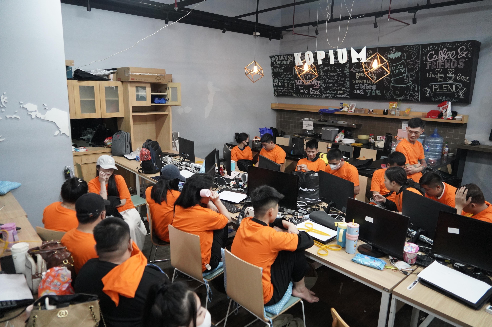

# Darurat judol: 80.000 anak Indonesia di bawah usia

JAKARTA: Sebanyak 200.000 anak Indonesia tercatat terpapar judi online (judol), termasuk sekitar 80.000 anak berusia di bawah 10 tahun. Kementerian Komunikasi dan Digital (Komdigi) mengungkap angka tersebut di tengah upaya pemerintah memperluas pemberantasan judol, tidak hanya melalui pemblokiran konten tetapi juga penelusuran transaksi dan aliran dana.

---

Persoalan perjudian digital juga ditemukan pada kelompok penerima bantuan sosial (bansos). Pada 2024, sebanyak 571.410 Nomor Induk Kependudukan (NIK) penerima bansos teridentifikasi terkait aktivitas judol. Nilai deposit yang tercatat mencapai sekitar Rp957 miliar melalui 7,5 juta transaksi. Temuan tersebut menjadi perhatian karena aktivitas perjudian berpotensi mengganggu kondisi ekonomi keluarga penerima bantuan.

---

Menteri Komunikasi dan Digital Meutya Hafid mengatakan dampak perjudian digital tidak hanya berkaitan dengan aktivitas di internet, tetapi juga menyangkut kehidupan masyarakat. **_"Di balik jutaan konten yang kita tangani ada kehidupan masyarakat yang harus dijaga. Ada penghasilan keluarga, masa depan anak, dan kehidupan sosial yang dapat terdampak. Itu sebabnya perlawanan terhadap judi online harus terus kita lakukan bersama"._**

Dalam periode 20 Oktober 2024 hingga 11 September 2026, pemerintah telah menangani 5,15 juta konten negatif. Sebanyak 4,03 juta di antaranya merupakan konten perjudian. Selain pemutusan akses, Komdigi memperkuat pengawasan terhadap penyelenggara platform digital melalui Sistem Kepatuhan Moderasi Konten (SAMAN).

Sepanjang Februari 2025 hingga 11 September 2026, mekanisme tersebut telah menangani 358 batch aduan yang mencakup 1.801 Uniform Resource Locator (URL) atau alamat tautan internet. SAMAN digunakan untuk memastikan platform digital menindaklanjuti laporan serta menjalankan kewajiban moderasi terhadap konten yang melanggar ketentuan.

Langkah tersebut diperlukan karena pelaku perjudian dapat berpindah dari satu platform ke platform lainnya untuk :

Penyebab Utama : 
- Menyebarkan konten                 
- Mengarahkan pengguna               
- Mempertahankan aktivitas transaksi 